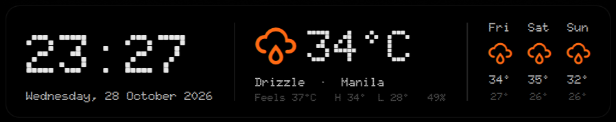

# Desktop Weather — an Omarchy shell plugin

A clock and weather card drawn on the desktop, above the wallpaper and below
your windows. It follows the active Omarchy theme.



- Current time, temperature (°C), feels-like, humidity, and a three-day forecast
- Weather from [Open-Meteo](https://open-meteo.com/), refreshed every 15 minutes
- Sits at the top center of every screen by default
- Drag to move it; left click to refresh
- A dragged position is kept until you change the display scale or text size,
  then the card goes back to the top center

## Install

```
omarchy plugin add https://github.com/hell0world69/omarchy-desktop-weather --enable
```

Update with `omarchy plugin update`, remove with
`omarchy plugin remove hell0world.desktop-weather`.

## Location and privacy

The location is detected from your public IP address through
[ipinfo.io](https://ipinfo.io/) on every refresh, so it follows you when you
travel. To use a fixed location instead, pick one in the bar's weather widget
popup; the card uses that and skips IP lookup. If detection fails before any
location is known, it falls back to Manila.

The dragged position is stored in
`$XDG_STATE_HOME/omarchy/desktop-weather.json`.

## License

MIT
